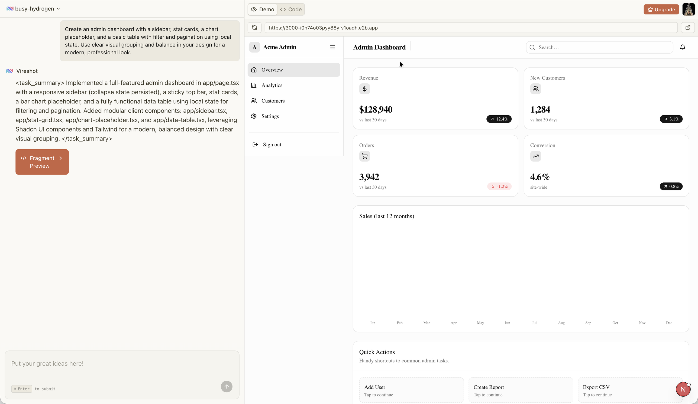
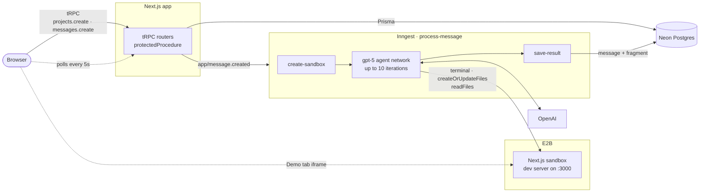

<div align="center">


# Vireshot

**Build websites by chatting with AI.**

Describe what you want, and a coding agent writes a Next.js app inside its own isolated cloud sandbox. You get a live preview and the full source code back in the browser.

[](https://nextjs.org)
[](https://react.dev)
[](https://www.typescriptlang.org)
[](https://trpc.io)
[](https://www.inngest.com)
[](https://e2b.dev)
[](https://www.prisma.io)
[](https://tailwindcss.com)

[Features](#features) · [How it works](#how-it-works) · [Tech stack](#tech-stack) · [Getting started](#getting-started) · [Project structure](#project-structure)

</div>

<p align="center">
  
</p>

---

## Features

- **Prompt to app.** Type what you want, or start from one of eight templates (a Netflix clone, a dashboard, a store and more). Each prompt becomes a **Project** with a random two-word name.
- **A sandbox per run.** The agent works in an isolated [E2B](https://e2b.dev) sandbox that already runs a Next.js 16 dev server with every shadcn/ui component installed.
- **A real coding agent.** An OpenAI `gpt-5` agent built on [Inngest Agent Kit](https://agentkit.inngest.com) runs terminal commands, writes files and reads files for up to 10 iterations, then replies with a summary.
- **Live preview.** The **Demo** tab shows the running sandbox app in an iframe, with refresh, copy link and open in a new tab.
- **Source code view.** The **Code** tab shows every generated file in a file tree with syntax highlighting and one-click copy.
- **Durable background runs.** Each generation runs as an [Inngest](https://www.inngest.com) function, so it keeps going after you close the tab and you can trace every step in the Inngest dashboard.
- **Visible failures.** Failed commands go back to the agent so it can fix them. If a run still fails, an error message shows in the chat instead of a spinner that never ends.

## How it works



1. **Creating a project.** A signed-in user submits a prompt on the home page. This creates a **Project** and its first `USER` **Message**, then sends an `app/message.created` event to Inngest.
2. **Starting a sandbox.** The `process-message` function starts an E2B sandbox from the `vire-nextjs-example` template with a 15-minute timeout.
3. **Running the agent.** The agent edits files and installs packages until it replies with a `<task_summary>`, or until it hits 10 iterations. Commands that fail or time out return their output to the agent instead of failing the step.
4. **Saving the result.** The summary is stored as an `ASSISTANT` message with a **Fragment** that holds the sandbox URL and the files the agent wrote. If the agent ends without a summary or without writing any files, or the function fails after its retries, an `ERROR` message is stored instead.
5. **Showing it.** The project page polls for new messages and shows the newest fragment in the **Demo** and **Code** tabs.

## Tech stack

| Layer | Tools |
| --- | --- |
| Framework | [Next.js 16](https://nextjs.org) (App Router, `src/proxy.ts`), [React 19](https://react.dev), TypeScript |
| API | [tRPC 11](https://trpc.io) with TanStack Query and superjson |
| AI | OpenAI `gpt-5` through [Inngest Agent Kit](https://agentkit.inngest.com) |
| Background jobs | [Inngest](https://www.inngest.com) |
| Sandboxes | [E2B](https://e2b.dev) with a custom Next.js + shadcn/ui template |
| Data | PostgreSQL on [Neon](https://neon.tech), [Prisma 7](https://www.prisma.io) with the Neon driver adapter |
| Auth | [Clerk](https://clerk.com) |
| UI | [shadcn/ui](https://ui.shadcn.com), Tailwind CSS 4, lucide-react, next-themes, Prism |
| Forms | React Hook Form, Zod 4 |
| Tests | [Vitest](https://vitest.dev) |

## Getting started

### Prerequisites

- Node.js 20 or later, and npm
- A PostgreSQL database. `src/lib/database.ts` uses `@prisma/adapter-neon`, so [Neon](https://neon.tech) is the simplest choice.
- Accounts on [Clerk](https://dashboard.clerk.com), [OpenAI](https://platform.openai.com) and [E2B](https://e2b.dev)
- [Docker](https://www.docker.com), to build the E2B sandbox template

### 1. Clone and install

```bash
git clone https://github.com/yusupscopes/vireshot.git
cd vireshot
npm install
```

### 2. Configure environment variables

```bash
cp .env.example .env
```

Use `.env`, not `.env.local`: the Prisma CLI loads only `.env` (see [`prisma.config.ts`](prisma.config.ts)).

| Variable | Where to get it |
| --- | --- |
| `DATABASE_URL` | Neon (or any Postgres) connection string |
| `NEXT_PUBLIC_APP_URL` | Public URL of the app, such as `http://localhost:3000`. Server-side tRPC calls use it. |
| `INNGEST_DEV` | Set to `1` to use the local Inngest Dev Server. Remove it in production. |
| `OPENAI_API_KEY` | OpenAI dashboard |
| `E2B_API_KEY` | E2B dashboard |
| `E2B_TEMPLATE_NAME` | Name of your E2B template. Defaults to `vire-nextjs-example`. |
| `NEXT_PUBLIC_CLERK_PUBLISHABLE_KEY`, `CLERK_SECRET_KEY` | Clerk dashboard |

The Clerk sign-in, sign-up and redirect URL variables in `.env.example` are already filled in.

### 3. Set up the database

```bash
npm run prisma:migrate    # apply migrations
npm run prisma:generate   # generate the client into src/generated/prisma
```

### 4. Build the E2B sandbox template

```bash
npm install -g @e2b/cli
e2b auth login
cd sandbox-templates/nextjs
e2b template build
```

This builds [`e2b.Dockerfile`](sandbox-templates/nextjs/e2b.Dockerfile) as `vire-nextjs-example`, with `/compile_page.sh` as the start command. If you use a different name, set `E2B_TEMPLATE_NAME` to match.

### 5. Run it

The app and the agent run as two processes. Start both:

```bash
# Terminal 1: the Next.js app on http://localhost:3000
npm run dev

# Terminal 2: the Inngest Dev Server on http://localhost:8288
npx inngest-cli@latest dev -u http://localhost:3000/api/inngest
```

Sign up, type a prompt, and watch the run in the Inngest dashboard.

## Scripts

| Command | Description |
| --- | --- |
| `npm run dev` | Start the Next.js dev server |
| `npm run build` | Build for production |
| `npm run start` | Serve the production build |
| `npm run lint` | Lint with ESLint |
| `npm test` | Run the Vitest tests |
| `npm run prisma:migrate` | Create or apply migrations (`prisma migrate dev`) |
| `npm run prisma:generate` | Regenerate the Prisma client |
| `npm run prisma:studio` | Open Prisma Studio |
| `npm run prisma:reset` | Drop the database and re-apply every migration |

## Project structure

```
vireshot/
├── prisma/
│   ├── schema.prisma        # Project, Message, Fragment models
│   └── migrations/
├── sandbox-templates/nextjs/  # E2B template: Next.js 16 + shadcn/ui, dev server on :3000
└── src/
    ├── app/
    │   ├── (home)/          # Landing page, project list, sign-in and sign-up
    │   ├── projects/[projectId]/  # Chat and preview workspace
    │   └── api/
    │       ├── trpc/        # tRPC HTTP handler
    │       └── inngest/     # Inngest serve endpoint
    ├── inngest/
    │   ├── functions.ts     # process-message: sandbox, agent, save result
    │   ├── tools.ts         # terminal, createOrUpdateFiles, readFiles
    │   ├── run-command.ts   # Returns failed and timed-out command output to the agent
    │   └── prompt.ts        # Agent system prompt
    ├── modules/
    │   ├── home/            # Landing page UI and prompt templates
    │   ├── projects/        # Project procedures and workspace UI
    │   └── messages/        # Message procedures
    ├── trpc/                # tRPC init, routers, client and server helpers
    ├── components/          # File explorer, tree view, code view, shadcn/ui
    ├── lib/database.ts      # Prisma client
    └── proxy.ts             # Clerk route protection
```

## Data model

- **Project**: `name` and `userId` (the Clerk user id). It has many messages.
- **Message**: `content`, `role` (`USER` | `ASSISTANT`) and `type` (`PROMPT` | `RESULT` | `ERROR`). It belongs to a project and has at most one fragment.
- **Fragment**: `sandboxUrl`, `title` and `files` (a JSON map of path to content). It belongs to one message.

Deleting a project cascades to its messages and fragments.

## Deployment

- **App:** set every variable from `.env.example`, remove `INNGEST_DEV`, and add `INNGEST_SIGNING_KEY` and `INNGEST_EVENT_KEY` from your Inngest app. Run `npx prisma migrate deploy` against the production database.
- **Agent:** register `https://<your-domain>/api/inngest` with Inngest Cloud, or use the Vercel integration.
- **Sandbox:** the E2B template must exist in the E2B team that owns `E2B_API_KEY`.

## Security notes

- `src/proxy.ts` runs Clerk on every request. Everything except `/`, `/sign-in`, `/sign-up`, `/api/inngest` and `/api/trpc` needs a session.
- Every tRPC procedure is a `protectedProcedure` that filters by the signed-in user's id, so users only see their own projects. A signed-out tRPC call gets `UNAUTHORIZED`, not a redirect.
- Prompts are validated with Zod and capped at 4,000 characters, both in tRPC and again in the Inngest function.
- Agent file paths are checked for `..` and null bytes, and file reads are size-limited.
- Each run gets its own sandbox, so generated code never runs on the app server.

## Current limitations

This is a work in progress:

- **Follow-ups start from scratch.** Each message gets a fresh sandbox, and the agent sees only the newest prompt, not the earlier conversation or files.
- **Previews expire.** Sandboxes time out after 15 minutes, so the saved preview URL stops working after that. The Code tab keeps the files.
- **No usage limits.** Billing and the `/pricing` page linked from the workspace aren't built yet.
- **Polling, not streaming.** The workspace polls for new messages every 5 seconds.

## Acknowledgements

Built with [Next.js](https://nextjs.org), [tRPC](https://trpc.io), [Inngest](https://www.inngest.com), [E2B](https://e2b.dev), [Prisma](https://www.prisma.io), [Neon](https://neon.tech), [Clerk](https://clerk.com) and [shadcn/ui](https://ui.shadcn.com).

<div align="center">

Made by [Yusup Maulana](https://github.com/yusupscopes)

</div>
